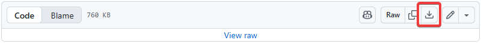
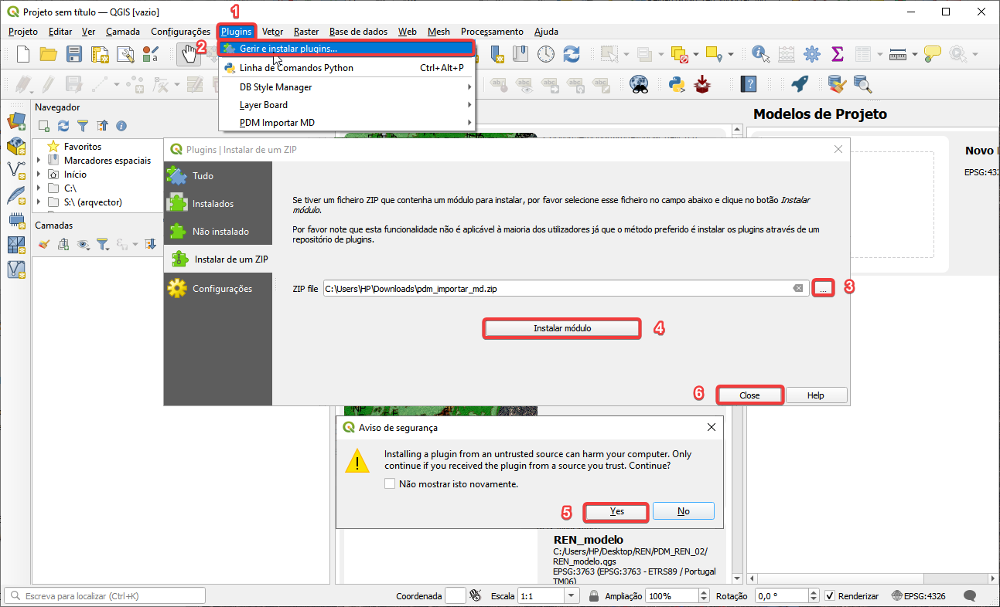
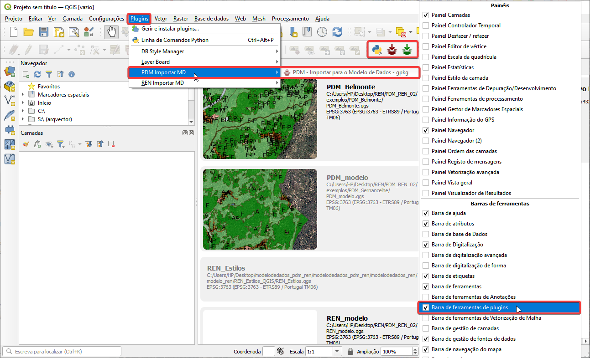
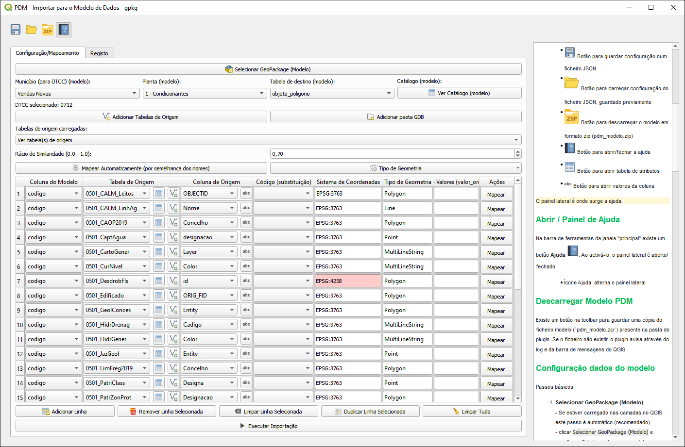
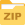
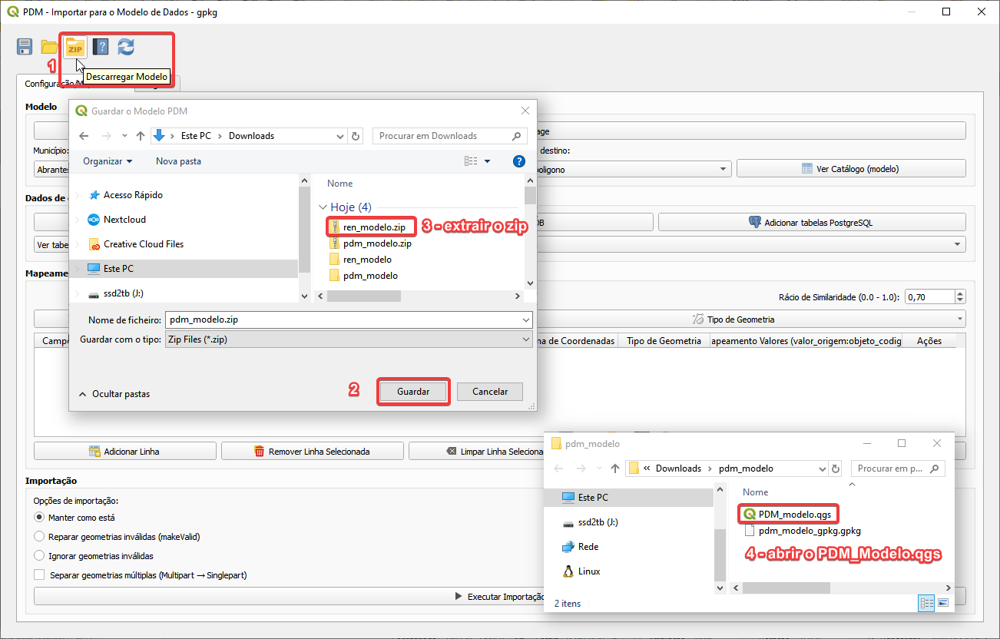
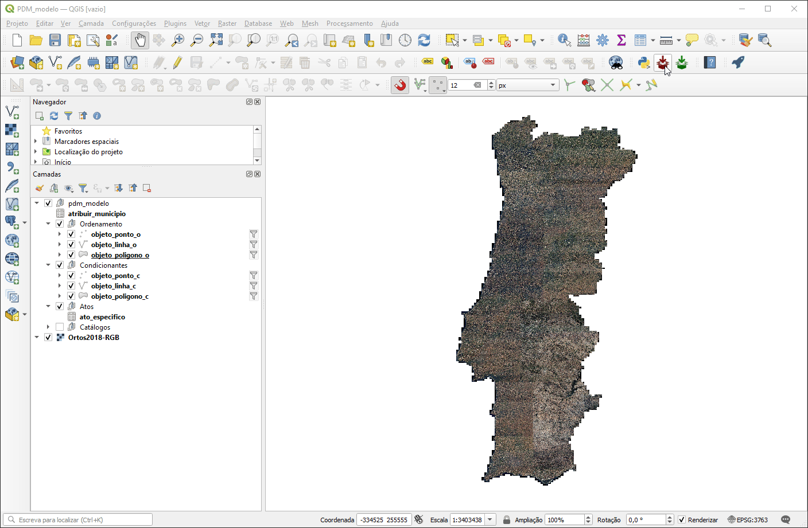

# Plugin QGIS para carregar dados para Modelo de Dados do PDM (Em Atualização)

Para apoio aos utilizadores na criação de ficheiros Geopackage de acordo com o Modelo de Dados do PDM proposto, é disponibilizado gratuitamente pela Direção-Geral do Território um plugin para o software livre [QGIS](https://qgis.org/) .

Este plugin permite auxiliar o utilizador a estruturar e carregar de forma interativa os seus dados geográficos existentes noutros formatos e com diferentes estruturas de informação para um ficheiro geopackage com toda a informação do PDM em conformidade com o modelo de dados proposto.

---

## Instalar o Plugin QGIS

1. Descarregar e guardar no computador o plugin clicando no link: [pdm_importar_md.zip](pdm_importar_md.zip)

   - [Descarregar ficheiro `.zip`](https://github.com/dgterritorio/modelodedados_pdm_ren/raw/refs/heads/main/modelosdedados/pdm/plugin_qgis/pdm_importar_md.zip)

2. Abrir o QGIS (recomendamos uma versão igual ou superior 3.44; o plugin é compatível com o QGIS 3.44 e com o QGIS 4.x)

3. Instalar o plugin descarregado - `pdm_importar_md.zip`

   - Seguir os passos da seguinte imagem

   - O plugin fica disponivel no separador `Plugins` e `Barra de ferramentas de plugins`

Aspeto da interface do plugin

## Utilização do Plugin QGIS

> Antes de mapear os objetos, deve verificar inicialmente no mapa se a informação está devidamente georreferenciada no sistema de coordenadas oficial - EPSG:3763 - ETRS89 / Portugal TM06.

O procedimento para a conversão de uma base de dados de origem para a base de dados modelo é o seguinte:

1. Instale o plugin `pdm_importar_md.zip`, descarregado do repositório GitHub, conforme descrito em [Instalar o Plugin QGIS](#instalar-o-plugin-qgis), e abra-o.
2. Clique no botão **Descarregar Modelo**, identificado pelo ícone , na Barra de Ferramentas do plugin.
3. Na janela **Guardar o Modelo PDM**, escolha a pasta onde pretende guardar o ficheiro `pdm_modelo.zip` e clique em **Guardar**.
4. Descompacte o ficheiro `pdm_modelo.zip`. Mantenha os ficheiros `PDM_modelo.qgs` e `pdm_modelo_gpkg.gpkg` na mesma pasta, para garantir o correto funcionamento do projeto.
5. Abra o projeto `PDM_modelo.qgs`.

6. Abra o plugin, faça o mapeamento dos dados de origem, execute a importação e analise os resultados.

[**Descarregar o vídeo (MP4)**](https://github.com/dgterritorio/modelodedados_pdm_ren/raw/refs/heads/main/modelosdedados/pdm/plugin_qgis/media/plugin.mp4)

### Outros exemplos

Importar dados de uma configuração `json` guardada - aplicada às condicionantes

[**Descarregar o vídeo (MP4)**](https://github.com/dgterritorio/modelodedados_pdm_ren/raw/refs/heads/main/modelosdedados/pdm/plugin_qgis/media/importar_json.mp4)
