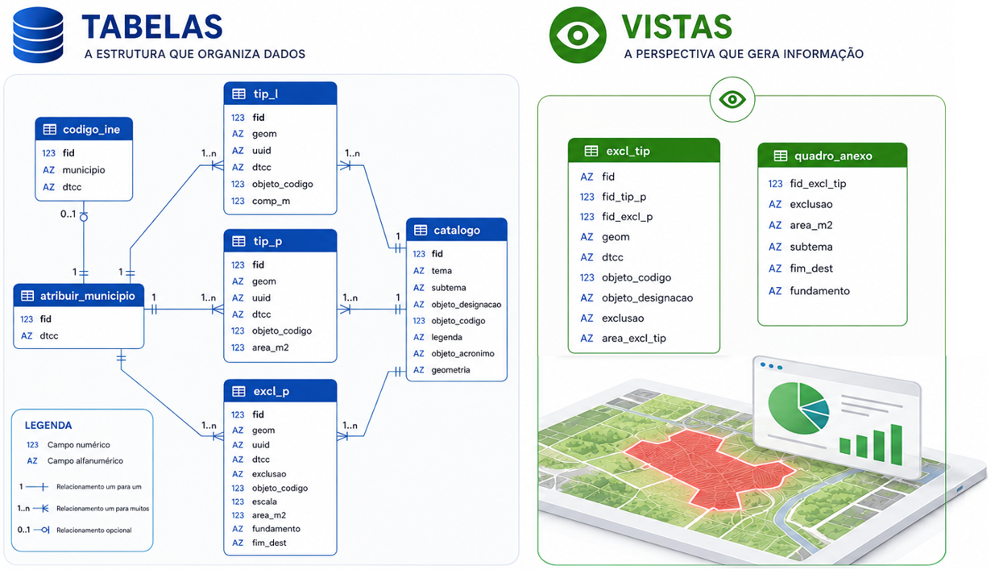

# Modelo de Dados da REN

Para apoiar a criação ou a configuração de bases de dados da carta de delimitação da Reserva Ecológica Nacional (REN), de acordo com o [Modelo de Dados da REN em vigor](https://cnt.dgterritorio.gov.pt/sites/default/files/Norma_Tecnica_Producao_reproducao_Cartas_REN.pdf), a Direção-Geral do Território disponibiliza um conjunto de recursos, incluindo um modelo de base de dados no formato [GeoPackage](https://www.geopackage.org/) (GPKG), formato aberto da OGC.

Os recursos encontram-se disponíveis neste repositório GitHub e destinam-se a apoiar a implementação, a utilização e a manutenção do Modelo de Dados da REN.

## Conteúdo do repositório

* `estilos` - ficheiros com a simbologia dos objetos geográficos para utilização no QGIS

* `info`
  * `compara_modelo_dados_ren.md` - correspondência entre os campos das tabelas do modelo de dados anterior e do modelo atual

* `media` - imagens associadas à documentação do modelo de dados da REN

* `modelo`
  * `REN_modelo.qgs` - projeto QGIS modelo para a criação e utilização da base de dados (inclui a simbologia prevista no Catálogo de Simbologia)
  * `ren_modelo_gpkg-catalogo.csv` - catálogo de objetos do modelo de dados
  * `ren_modelo_gpkg.gpkg` - modelo da base de dados em formato GeoPackage

* `norma`
  * `README.md` - texto da norma técnica da carta de delimitação da REN

* `plugin_qgis` - ficheiros relativos ao Plugin QGIS desenvolvido pela DGT
  * `ajuda` - ajuda do plugin (`ajuda.html` e imagens), consultada pelo plugin quando há ligação à internet
  * `media` - imagens e vídeo da documentação do plugin
  * `LICENSE` - licença de utilização do plugin
  * `README.md` - instruções de instalação e utilização do plugin
  * `VERSION_INFO.json` - versões atuais do plugin, do GeoPackage modelo e do projeto modelo, usadas pelo plugin para verificar se há atualizações
  * `ren_importar_md.zip` - plugin para instalação no QGIS

* `sql`
  * `ren_modelo_gpkg.sql` - estrutura da base de dados modelo, incluindo tabelas, vistas e triggers para o cálculo automático de áreas e comprimentos
  * `ren_modelo_postgres.sql` - estrutura da base de dados modelo para PostgreSQL/PostGIS
  * `ren_modelo_postgres_multi_dtcc.sql` - estrutura da base de dados modelo para PostgreSQL/PostGIS, com suporte à utilização por múltiplos DTCC

* `LICENSE` - licença de utilização de software livre, GNU AGPLv3

* `README.md` - documentação geral sobre o Modelo de Dados da REN

---

## Plugin QGIS

O plugin desenvolvido pela DGT permite apoiar a criação de cartas de delimitação da REN de acordo com o Modelo de Dados em vigor, bem como a conversão de bases de dados de origem para a estrutura da base de dados modelo.

Mais informação sobre o Plugin QGIS, incluindo instruções de utilização e os ficheiros necessários à sua instalação, encontra-se disponível [aqui](plugin_qgis).

---

## Estrutura da Base de Dados

### Tabelas

- `codigo_ine`
   Lista os municípios e os respetivos códigos da divisão administrativa do Instituto Nacional de Estatística (código DTCC).
- `atribuir_municipio`
   Identifica o município de trabalho do utilizador. Esta tabela contém um único registo e funciona como elemento de configuração, centralizando a identificação do território a que os dados se referem através do código DTCC. O respetivo código atua como chave estrangeira nas tabelas gráficas, garantindo a integridade referencial. Qualquer alteração ao registo é automaticamente refletida nas tabelas dependentes, assegurando a associação de todos os dados ao mesmo município.
- `catalogo`
   Identifica os objetos que podem existir na base de dados, a natureza geométrica que cada objeto pode assumir e a sua organização na carta da REN.
- `tip_l`
   Contém os objetos espaciais do tipo **linear** – leitos dos cursos de água, canalizados ou não. Esta tabela possui triggers para:
  - gerar UUID;
  - calcular automaticamente o comprimento em metros (`comp_m`).
- `tip_p`
   Contém os objetos espaciais do tipo **poligonal** que correspondem às tipologias delimitadas na carta da REN, antes de serem ponderadas as exclusões. Esta tabela possui triggers para:
  - gerar UUID;
  - calcular automaticamente a área em m² (`area_m2`).
- `excl_p`
   Contém os objetos espaciais do tipo **poligonal** que correspondem às áreas de exclusão. Esta tabela possui triggers para:
  - gerar UUID;
  - calcular automaticamente a área em m² (`area_m2`).

---

### Vistas de apoio (view)

Permitem a análise e a consulta dos dados do catálogo de objetos e do quadro anexo à carta de delimitação da REN:

- `excl_tip`
   Identifica as diferentes tipologias abrangidas por cada exclusão. Esta vista resulta de uma query SQL que calcula a interseção espacial entre as geometrias das tabelas `tip_p` e `excl_p` com o mesmo DTCC. Como resultado, são gerados os polígonos correspondentes às áreas de sobreposição, preservando os atributos das respetivas tabelas de origem e calculando a área de cada interseção.
- `quadro_anexo`
   Agrega a informação necessária à elaboração do Quadro Anexo publicado no Diário da República, identificando, para cada exclusão, as tipologias REN abrangidas, a superfície excluída, a fundamentação e o fim a que se destina. Esta vista resulta de uma query SQL que relaciona e agrega atributos da vista `excl_tip` e das tabelas `excl_p` e `catalogo`.

Diagrama da Base de Dados

> [Abrir a correspondência de campos entre o modelo de dados em vigor e a versão anterior](info/compara_modelo_dados_ren.md).

---

### Vistas auxiliares

Visam facilitar a consulta e a utilização do plugin:

- `catalogo_tip_l`
   Lista os objetos com geometria linear que correspondem às tipologias.
- `catalogo_tip_p`
   Lista os objetos com geometria poligonal que correspondem às tipologias.
- `catalogo_excl_p`
   Lista os objetos com geometria poligonal que correspondem às exclusões.

---

### Triggers de Cálculo Automático

- **Áreas (**`area_m2`**)**: calculadas automaticamente nas tabelas com geometrias poligonais.
- **Comprimentos (**`comp_m`**)**: calculados automaticamente nas tabelas com geometrias lineares.
- **Atualização automática** em caso de alteração da geometria.

---

## Observações Técnicas

- **Codificação:** UTF-8.
- **UUIDs:** gerados automaticamente nas tabelas geométricas.
- **Área:** armazenada em **m²**.
- **Comprimento:** armazenado em **metros**.

> Algumas funcionalidades (como colunas `GENERATED ALWAYS`) requerem **SQLite ≥ 3.31**.

---
