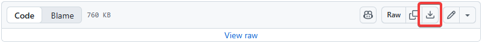
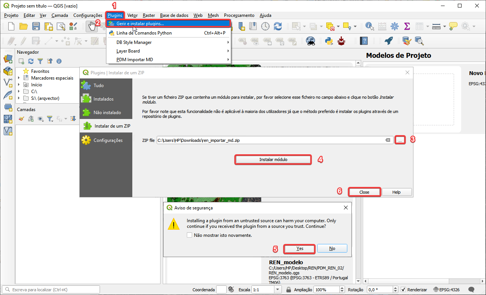
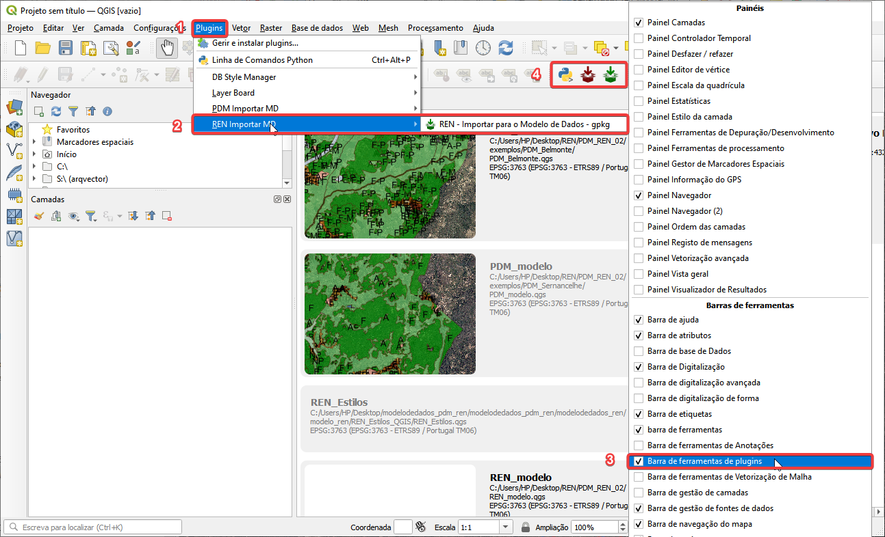
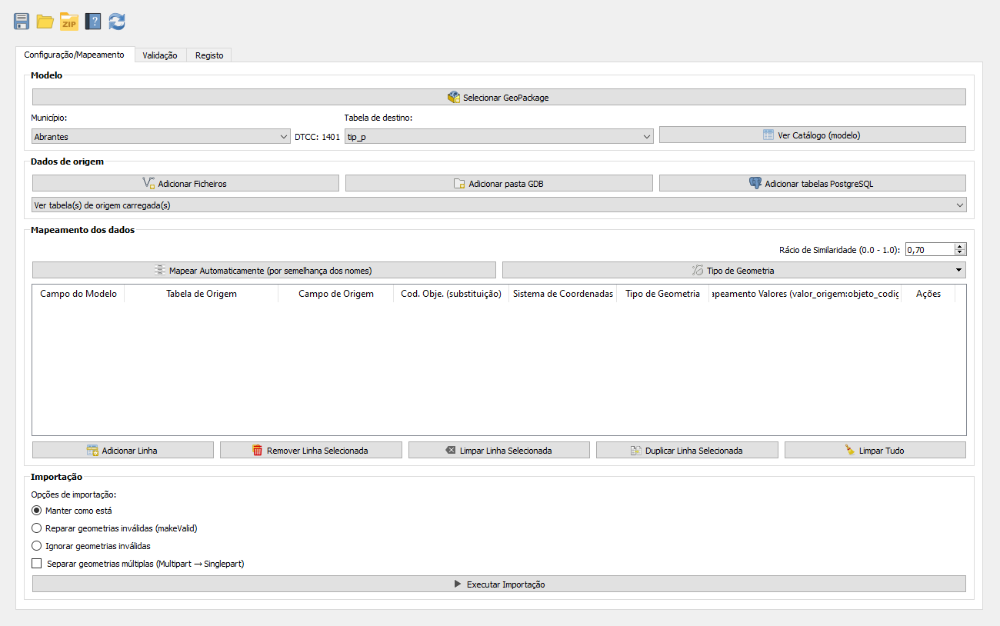
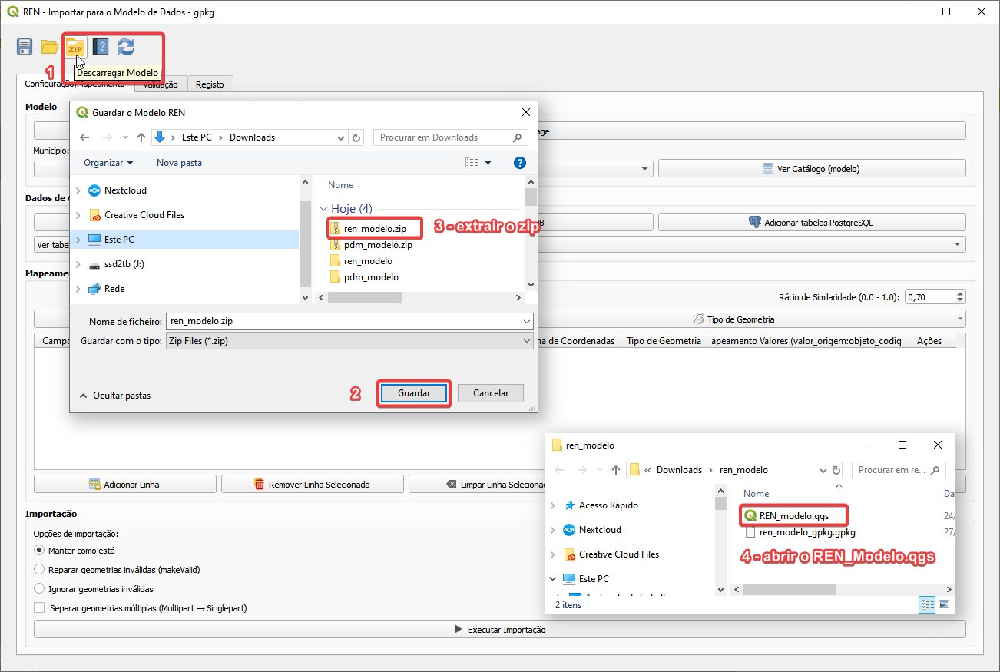
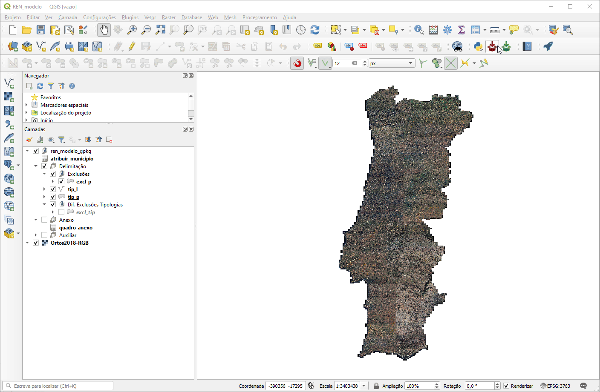

# Plugin QGIS para carregar dados para Modelo de Dados da REN

Para apoio aos utilizadores na criação de ficheiros GeoPackage de acordo com o Modelo de Dados da REN, é disponibilizado gratuitamente pela Direção-Geral do Território um plugin para o software livre [QGIS](https://qgis.org/).

Este plugin permite auxiliar o utilizador a estruturar e carregar de forma interativa os seus dados geográficos, existentes noutros formatos e com diferentes estruturas de informação, para um ficheiro GeoPackage estruturado em conformidade com o modelo de dados.

---

## Instalação do Plugin QGIS

### 1. Descarregar o plugin

Descarregue a versão mais recente do plugin [`ren_importar_md.zip`](ren_importar_md.zip) a partir do [repositório GitHub](https://github.com/dgterritorio/modelodedados_pdm_ren/tree/main/modelosdedados/ren/plugin_qgis) e guarde o ficheiro no computador.

- [Descarregar diretamente o ficheiro `.zip`](https://github.com/dgterritorio/modelodedados_pdm_ren/raw/refs/heads/main/modelosdedados/ren/plugin_qgis/ren_importar_md.zip)

### 2. Abrir o QGIS

Abra o QGIS utilizando uma versão igual ou superior a 3.44. O plugin é compatível com o QGIS 3.44 (Qt5) e com o QGIS 4.x (Qt6).

Caso necessário, descarregue a versão mais recente do QGIS [aqui](https://qgis.org/download/).

### 3. Instalar o plugin

No QGIS, instale o plugin `ren_importar_md.zip` seguindo a sequência de passos apresentada na figura:

Após a instalação, o plugin fica disponível no menu `Plugins` e na `Barra de ferramentas de plugins`, no botão , conforme ilustrado na figura seguinte:

### Interface do plugin

A interface do plugin é composta por uma **Barra de Ferramentas** e três separadores: **Configuração/Mapeamento**, **Validação** e **Registo**.

- A **Barra de Ferramentas** localiza-se na parte superior esquerda da interface do plugin e reúne os botões de acesso rápido a funcionalidades de apoio à sua utilização, nomeadamente guardar e carregar configurações, descarregar o modelo, aceder à ajuda e verificar se há novas versões.
- O separador **Configuração/Mapeamento** permite converter dados de origem, provenientes de diferentes formatos e fontes de dados (GPKG, PostgreSQL/PostGIS, SHP, MPK, CSV e pastas GDB), para o modelo de dados da REN, em formato GeoPackage. Está organizado em quatro caixas: **Modelo**, **Dados de origem**, **Mapeamento dos dados** e **Importação**. A conversão é realizada através do mapeamento de campos e de valores, de acordo com o Catálogo de Objetos, a Geometria dos Objetos e a Estrutura da Base de Dados Geográfica, previstos na Parte II e nos Anexos I e II da [Norma Técnica da REN](https://cnt.dgterritorio.gov.pt/).
- O separador **Validação** reúne as ferramentas de validação e correção da Carta de Delimitação da REN, agrupadas em **Geometria**, **Representação** e **Classificação**, com o objetivo de verificar a sua conformidade com as Boas Práticas na Digitalização e Classificação dos Objetos, previstas no Anexo III da Norma Técnica da REN.
- O separador **Registo** (Log) apresenta todas as mensagens geradas pelo plugin.

A descrição da Barra de Ferramentas e a explicação do modo de funcionamento de cada separador encontram-se detalhadas na Ajuda do plugin (botão ).

---

## Utilização do Plugin QGIS

### Descarregar e abrir o modelo de dados

Para iniciar a utilização das opções e ferramentas de configuração e execução dos processos de importação e conversão dos dados, é necessário carregar o modelo de dados para a área de trabalho.

O carregamento do modelo de dados pode ser efetuado de duas formas distintas, consoante o objetivo do utilizador:

- **A.** Utilizar o modelo completo, incluindo as simbologias do Catálogo de Simbologia da REN;
- **B.** Manter as camadas e configurações de visualização do utilizador, ou seja, trabalhar com a base de dados modelo sem utilizar as camadas e configurações de visualização definidas no projeto predefinido.

#### A. Utilizar o modelo completo

1. Instale o plugin `ren_importar_md.zip`, descarregado do repositório GitHub, conforme descrito em [Instalação do Plugin QGIS](#instalação-do-plugin-qgis), e abra-o.
2. Clique no botão **Descarregar Modelo**, identificado pelo ícone , na Barra de Ferramentas do plugin.
3. Na janela **Guardar o Modelo REN**, escolha a pasta onde pretende guardar o ficheiro `ren_modelo.zip` e clique em **Guardar**.
4. Descompacte o ficheiro `ren_modelo.zip`. Mantenha os ficheiros `REN_modelo.qgs` e `ren_modelo_gpkg.gpkg` na mesma pasta, para garantir o correto funcionamento do projeto.
5. Abra o projeto `REN_modelo.qgs`. As tabelas do modelo (`tip_p`, `tip_l` e `excl_p`) são apresentadas no Painel de Camadas do QGIS e o plugin deteta o GeoPackage automaticamente.

#### B. Manter as camadas e simbologias do utilizador

A importação de dados de origem para a base de dados modelo pode ser realizada sem abrir o projeto QGIS predefinido. O utilizador pode trabalhar com as suas próprias camadas e simbologias, independentemente das camadas e configurações de visualização definidas no projeto modelo, uma vez que a base de dados funciona de forma autónoma.

1. Siga os passos 1 a 4 da opção A para descarregar e descompactar o ficheiro `ren_modelo.zip`.
2. Sem abrir o projeto `REN_modelo.qgs`, no separador **Configuração/Mapeamento**, caixa **Modelo**, use **Selecionar GeoPackage** para escolher o ficheiro `ren_modelo_gpkg.gpkg`.

### Importar dados para o modelo

> Antes de proceder ao mapeamento dos objetos, verifique se os dados estão corretamente georreferenciados e utilizam o sistema de coordenadas oficial ETRS89 / Portugal TM06 (EPSG:3763).

Para realizar a importação de dados, consulte a Ajuda do plugin no botão  e veja o vídeo de demonstração:

<!-- Para mostrar aqui o vídeo com controlos (pausa, avanço e recuo): editar este README no github.com,
     arrastar uma versão do media/plugin.mp4 com menos de 10 MB para o editor e substituir a linha do gif
     pelo link https://github.com/user-attachments/assets/... que o GitHub gera. -->

Para acompanhar ao seu ritmo, [descarregue o vídeo](https://github.com/dgterritorio/modelodedados_pdm_ren/raw/refs/heads/main/modelosdedados/ren/plugin_qgis/media/plugin.mp4) (MP4, 40 MB) e abra-o num leitor de vídeo, onde pode pausar, recuar e reduzir a velocidade.

Se abrir o plugin sem o modelo de dados carregado no projeto, aparece a seguinte mensagem:

> Nenhum GeoPackage com tabelas 'tip_p', 'tip_l' ou 'excl_p' foi encontrado. Por favor, carregue o modelo de dados no mapa antes de usar o plugin.

Nesse caso, abra o projeto `REN_modelo.qgs` (opção A) ou use **Selecionar GeoPackage** (opção B).

### Ver a sobreposição das tipologias com as exclusões (`excl_tip`)

A `excl_tip` é uma vista do GeoPackage: não é preciso gerá-la, porque é calculada automaticamente a partir dos dados existentes nas tabelas `tip_p` e `excl_p`. Para ver o resultado, no projeto `REN_modelo.qgs`, ative a camada `excl_tip` no grupo **Dif. Exclusões Tipologias** do Painel de Camadas, ou abra a sua tabela de atributos.

A vista calcula a interseção espacial entre as tipologias (`tip_p`) e as exclusões (`excl_p`) do mesmo DTCC. Cada polígono corresponde à parte de uma tipologia abrangida por uma exclusão e tem o código e a designação da tipologia, a exclusão e a área da interseção em m² (`area_excl_tip`).

Como a vista é recalculada sempre que é apresentada, com muitos elementos pode demorar alguns minutos a ser desenhada.

### Visualizar o Quadro Anexo

No projeto `REN_modelo.qgs`, no grupo **Anexo** do Painel de Camadas, abra a tabela de atributos da camada `quadro_anexo` (botão direito sobre a camada > **Abrir tabela de atributos**).

A vista `quadro_anexo` agrega a informação necessária à elaboração do Quadro Anexo publicado no Diário da República. Para cada exclusão identifica as tipologias REN abrangidas, a área de cada uma (m²), o fim a que se destina e a síntese da fundamentação. Resulta de uma consulta SQL que relaciona a vista `excl_tip` com as tabelas `excl_p` e `catalogo`.
